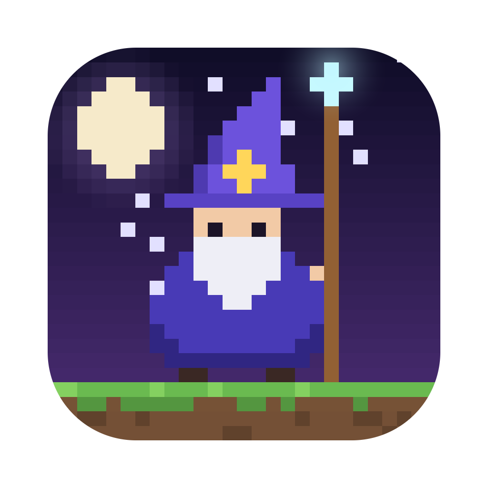
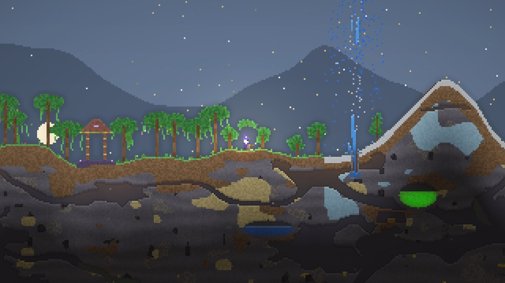
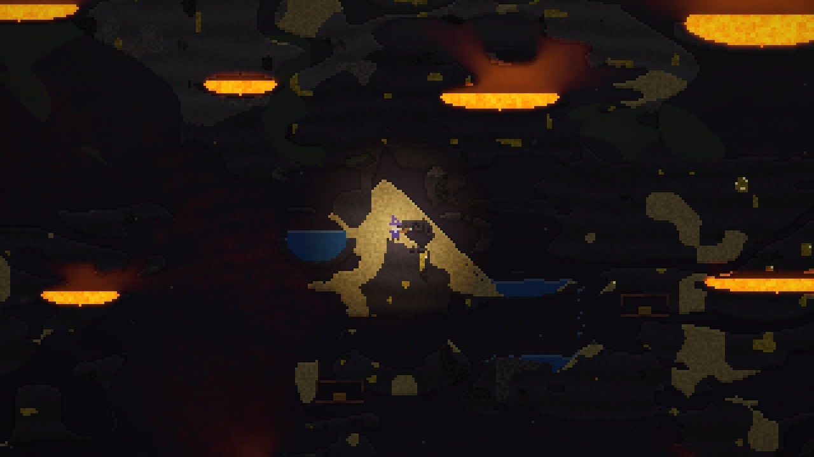
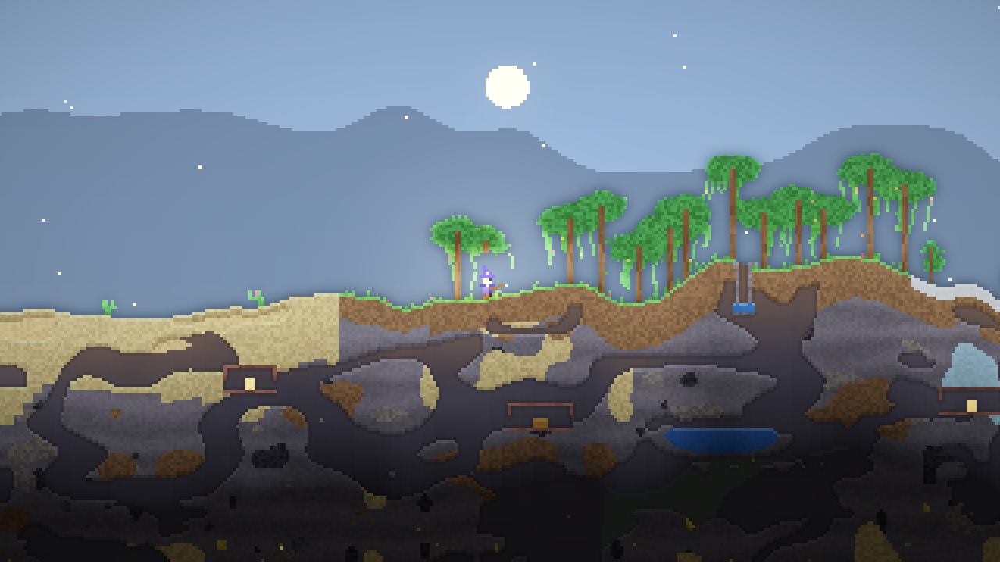
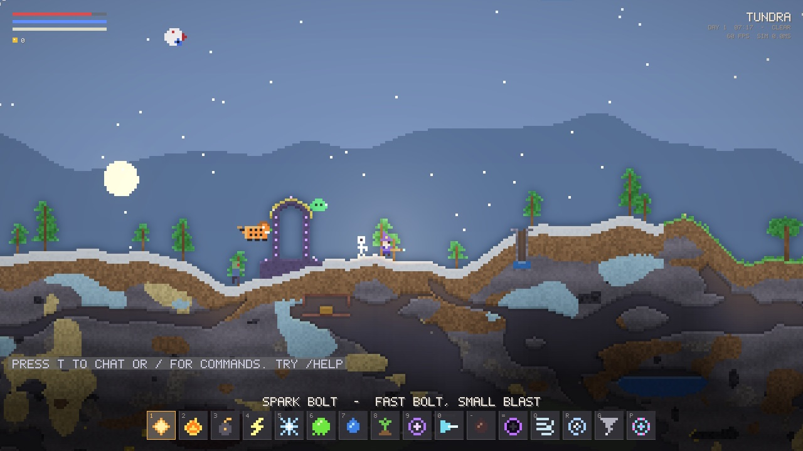
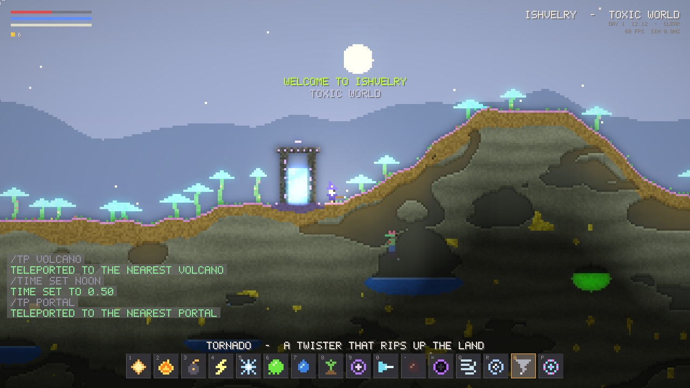
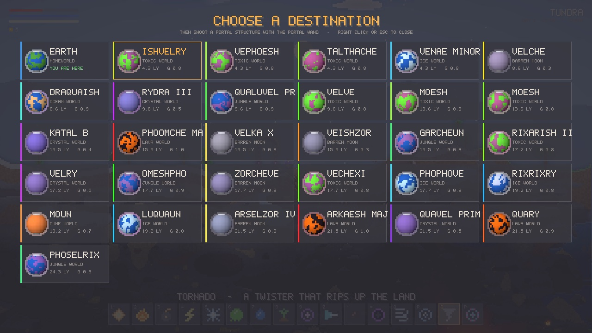
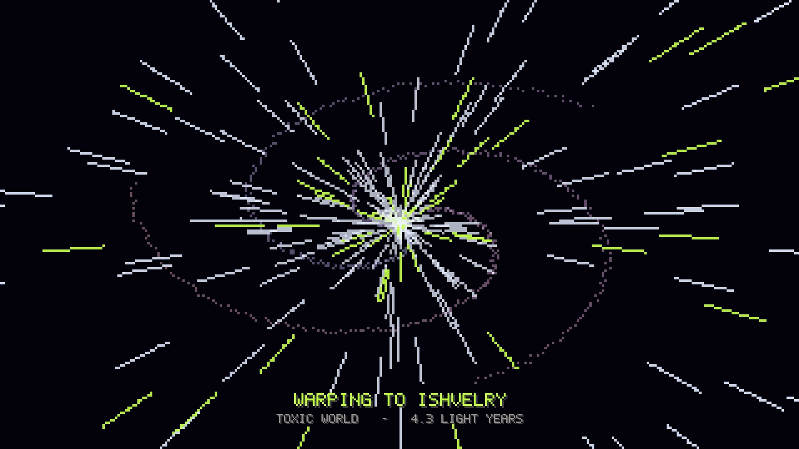

<div align="center">



# Falling Wizard

**A falling-sand wizard game where every grain is alive.**<br>
An infinite world, sixteen spells, twenty-four creatures, and a galaxy of planets to warp to.

[**Website**](https://fw.crooli.com) &nbsp;·&nbsp; [Install](#install) &nbsp;·&nbsp; [Spells](#spells) &nbsp;·&nbsp; [Commands](#commands) &nbsp;·&nbsp; [Controls](#controls)

  

<br>



</div>

<br>

## Install

Paste this into Terminal on a Mac:

```bash
curl -fsSL https://fw.crooli.com/install.sh | bash
```

It builds the game on your machine (a couple of minutes the first time), adds **Falling Wizard** to your Applications, and gives you a `falling-wizard` command. After that the game keeps itself up to date: when a new version is out, the main menu shows an **Update available** button.

<details>
<summary><b>Build it yourself</b></summary>

<br>

```bash
git clone https://github.com/xandertaylorx/falling-wizard
cd falling-wizard
cargo run --release
```

Needs Rust (from [rustup.rs](https://rustup.rs)) and Apple's command line tools.

</details>

<br>

## A world made of pixels

<table>
<tr>
<td width="50%"><br><sub><b>Ray-traced light.</b> Lava lights up caverns, sunlight pours into cave mouths, terrain casts real shadows.</sub></td>
<td width="50%"><br><sub><b>An endless Earth.</b> Oceans, beaches, plains, forests, jungles, deserts and tundra, with caves and ruins below.</sub></td>
</tr>
<tr>
<td width="50%"><br><sub><b>Creatures.</b> Lions pounce, demon eyes stare, dragons breathe fire, and everything dies the way you killed it.</sub></td>
<td width="50%"><br><sub><b>Other worlds.</b> Open a portal and warp to a procedurally generated planet.</sub></td>
</tr>
</table>

Every grain of sand, drop of water and lick of flame is simulated:

- **Sand** piles into dunes, **water** finds its level, **oil** floats, burns, and explodes when it's pooled deep enough.
- **Acid** eats through almost anything (except glass), **lava** boils water into steam and cools into basalt, lightning fuses sand into glass.
- **Gunpowder** chain-reacts, cave **gas** flashes into fire, gravel ceilings collapse, quicksand swallows you.
- **Trees and plants** stand in a background layer: you, water and sand pass through them, but they still catch fire.
- **Weather** drifts between clear, cloudy, rain, thunderstorms, fog and wind, through a full day and night. Snow settles in the tundra, sandstorms sweep the desert, and lightning hunts for trees.
- **Up:** cloud platforms, sky isles, then the edge of the atmosphere (with aurora at night), low gravity, and floating astral islands among the stars.
- **Down:** caves that widen with depth, ruins with chests and altars, volcanoes and geysers, and basalt caverns over lakes of lava.

<br>

## Spells

Every spell has its own key, or use the mouse wheel.

| Key | Spell | | Key | Spell |
|:-:|---|---|:-:|---|
| `1` | **Spark Bolt**: quick bolt, small blast | | `9` | **Teleport**: blink to where it lands |
| `2` | **Fireball**: arcs and sets everything alight | | `0` | **Digging Beam**: bores through rock |
| `3` | **Bomb**: bounces, ticks, levels the area | | `-` | **Oil Spray**: lay down fuel, add a spark |
| `4` | **Lightning**: forks, chains, scorches | | `=` | **Black Hole**: bends light, swallows everything |
| `5` | **Frost**: freezes water, turns lava to stone | | `Q` | **Wind**: hold to blow a gale |
| `6` | **Acid Ball**: splashes corrosive acid | | `R` | **Hurricane**: flings the ground into the sky |
| `7` | **Torrent**: a spray of water | | `G` | **Tornado**: a twister that rips up the land |
| `8` | **Seeds of Life**: grow plants, tame creatures | | `P` | **Portal Wand**: open gates to other planets |

<br>

## Creatures

Zombies, skeletons, slimes, demon eyes, bats, fire imps, lions, tigers, scorpions, snow wolves, yetis, golems, salamanders, the Devourer, dragons, ghosts, mushlings, fish and sharks on Earth, plus star jellies, moon hoppers, void eyes, wisps and cloud sprites up in the sky and out in space. They spawn by biome, depth, altitude, time of day and planet.

They die the way they're killed. Fire turns them to ash, lightning X-rays their skeleton, frost shatters them, acid melts them into goo, explosions and wind send them tumbling, and black holes spaghettify them. Cast **Seeds of Life** straight at one to make it your pet (up to three).

<br>

## The galaxy

<table>
<tr>
<td width="50%"></td>
<td width="50%"></td>
</tr>
</table>

Earth sits at the centre of an endless galaxy of generated planets: dune worlds, ice worlds, lava worlds, jungle and toxic worlds with giant glowing mushrooms, crystal worlds, ocean worlds and barren moons. Each has its own ground, seas, plants, sky, gravity and creatures.

1. **Tune.** Hold the **Portal Wand** and right-click to spin the planet selector. Pick one of the thirty nearest worlds. Earth is always there.
2. **Open.** Shoot a portal structure: stone arches, crystal rings, basalt monoliths and brick temples stand all over every world.
3. **Warp.** Walk in and cross the galaxy at lightspeed. A portal home is waiting when you land.

<br>

## Controls

| Input | Action |
|---|---|
| `A` `D` | Move |
| `W` / `Space` | Jump, wall-jump, hold to fly |
| `S` | Glide |
| `Shift` | Dash |
| `F` | Grappling vine |
| Left mouse | Cast the selected spell |
| Right mouse | Dig (or open the planet selector with the Portal Wand) |
| `E` | Open chests, use altars |
| `B` | Sandbox brush: paint any material |
| `T` / `/` | Chat / commands |
| `Esc` / `F11` | Pause / fullscreen |

<br>

## Commands

Press `T` to chat or `/` for commands. Suggestions pop up as you type and `Tab` completes them.

| Command | |
|---|---|
| `/tp volcano` | Also `portal`, `ruin`, `altar`, `island`, `space`, `caves`, `lava`, `ocean`, `beach`, `jungle`, `desert`, `tundra`, `spawn`, or `/tp <x> <y>` |
| `/time set night` | `day`, `noon`, `evening`, `night`, `midnight` or `0`–`1` |
| `/weather storm` | `clear`, `cloudy`, `rain`, `storm`, `fog`, `windy` |
| `/summon dragon 3` | Any creature, any number |
| `/fly` · `/god` | Infinite flight · can't be hurt |
| `/kill` · `/heal` · `/gold 500` | Clear creatures · restore yourself · pocket money |
| `/help` | Everything else |

<br>

## Under the hood

Written in Rust with [macroquad](https://github.com/not-fl3/macroquad), with **no asset files**. Every pixel is simulated or drawn in code, the font is hand-made in code, every sound is synthesised when the game starts, and even the app icon is drawn by a script.

- **The world** is generated chunk by chunk from a seed. Only the area around you is simulated, and anything that has settled sleeps, so busy scenes stay smooth.
- **The simulation** steps at a fixed rate, independent of your display. The game draws at whatever your screen refreshes at, so it's not capped at 60.
- **Lighting** is ray-marched on the GPU every frame, then blurred, tone-mapped and bloomed.

<details>
<summary><b>Project layout</b></summary>

<br>

| File | |
|---|---|
| `world.rs` | Streaming chunk window, sleeping sim chunks, all material rules |
| `worldgen.rs` | Biomes, terrain layers, caves, ruins, portals, sky islands, alien planets |
| `planets.rs` | The procedural galaxy |
| `materials.rs` · `cell.rs` | Material properties, per-cell state |
| `player.rs` | Wizard movement and health |
| `spells.rs` | Spells, projectiles, black holes, tornadoes |
| `mobs.rs` | Creatures, behaviours, spawning, deaths |
| `weather.rs` | Day, night and weather |
| `fx.rs` | Particles and explosions |
| `render.rs` | Sky, lighting shaders, compositing |
| `ui.rs` | Pixel font, HUD, planet selector, chat |
| `audio.rs` | Synthesised sound |
| `updater.rs` | Self-updates |
| `game.rs` · `main.rs` | Game state, commands, screens |
| `tools/make_icon.py` | Draws the app icon |
| `web/` | The website at [fw.crooli.com](https://fw.crooli.com) (deployed by Vercel on every push) |

</details>

<details>
<summary><b>Developer flags</b></summary>

<br>

| Flag | |
|---|---|
| `--bench` | Headless benchmark plus material behaviour checks |
| `--autotest 22 <dir>` | Scripted, muted tour that prints frame stats and saves screenshots |
| `--photos <dir>` | HUD-free tour that saves the screenshots used on the website |
| `--update` · `--version` | Update now · print the build's commit |
| `--mute` | Start without sound |

</details>

<br>

## Licence

© 2026 Falling Wizard. **All rights reserved.** The source is public to read, but it isn't open source: see [LICENSE](LICENSE). You're very welcome to install and play the game.
